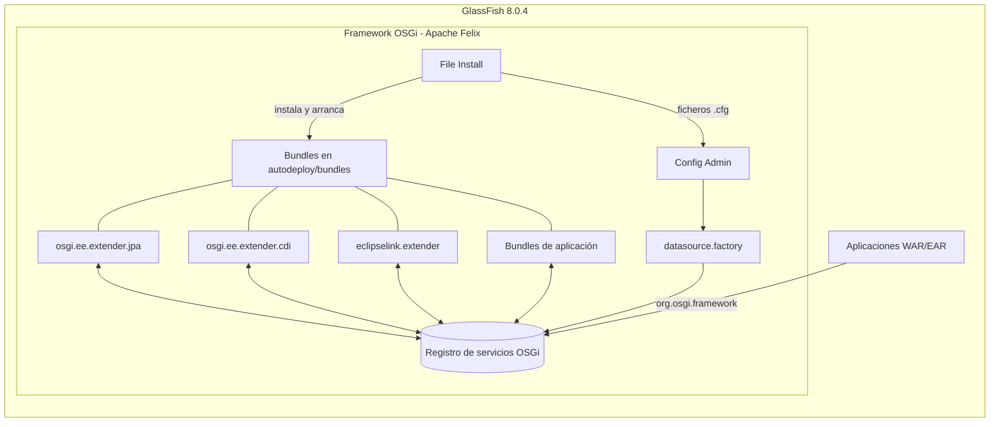
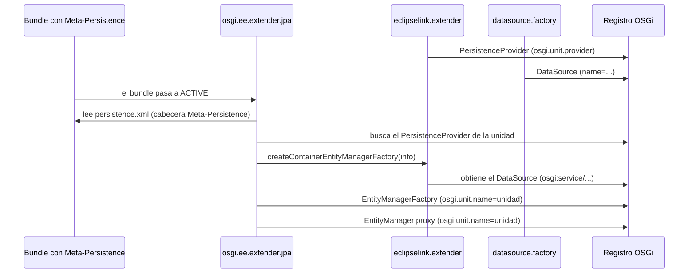

# Guía de uso de los extenders OSGi Jakarta EE en GlassFish 8.0.4

Versión de los bundles: **2.0.0** · Servidor: **Eclipse GlassFish 8.0.4** (Jakarta EE 11, Java 21)

## Índice

1. [Qué es este proyecto](#1-qué-es-este-proyecto)
2. [Componentes](#2-componentes)
3. [Cómo funciona](#3-cómo-funciona)
4. [Requisitos](#4-requisitos)
5. [Compilación](#5-compilación)
6. [Despliegue en GlassFish 8.0.4](#6-despliegue-en-glassfish-804)
7. [Configuración](#7-configuración)
8. [Desarrollo de bundles de aplicación](#8-desarrollo-de-bundles-de-aplicación)
9. [Integración con aplicaciones Jakarta EE (WAR/EAR)](#9-integración-con-aplicaciones-jakarta-ee-warear)
10. [Migración de bundles de la versión 1 (`javax.*`)](#10-migración-de-bundles-de-la-versión-1-javax)
11. [Diagnóstico y solución de problemas](#11-diagnóstico-y-solución-de-problemas)
12. [Limitaciones conocidas](#12-limitaciones-conocidas)
13. [Referencia rápida](#13-referencia-rápida)

---

## 1. Qué es este proyecto

GlassFish ejecuta sus propios módulos sobre un framework OSGi embebido (Apache Felix 7.0.5). Este proyecto
añade a ese framework un conjunto de *extenders*: bundles que observan los demás bundles instalados y,
según sus cabeceras de manifiesto, les proporcionan servicios Jakarta EE:

- **JPA (Jakarta Persistence 3.2):** un bundle que declara unidades de persistencia obtiene, para cada unidad,
  un `EntityManagerFactory` y un `EntityManager` publicados como servicios OSGi.
- **JTA (Jakarta Transactions 2.0):** un gestor de transacciones y un `UserTransaction` publicados como servicios.
- **CDI (Jakarta CDI 4.1):** un bundle que lo solicita obtiene su propio contenedor CDI (Weld 6.0.4), puede
  inyectar servicios OSGi en sus beans y publicar beans como servicios OSGi.
- **Datasources:** `javax.sql.DataSource` con pool de conexiones, creados solo con configuración.

El objetivo original del proyecto (manual de la versión 1.0.0) se mantiene: acoplar los estándares solo
mediante servicios OSGi, sin introducir interfaces propias para el desarrollador más allá de dos
anotaciones (`@Service` y `@ServiceReference`).

La versión 2.0.0 adapta el proyecto al espacio de nombres `jakarta.*` y a GlassFish 8.0.4. Utiliza las APIs
y la implementación JPA (EclipseLink 5.0.1) que trae GlassFish, de modo que no hace falta instalar
dependencias adicionales salvo el *runtime* de Declarative Services (Felix SCR), que se distribuye con los bundles.

### Qué aporta frente a una aplicación Jakarta EE normal

En una aplicación WAR/EAR, GlassFish gestiona la persistencia, las transacciones y CDI por aplicación. Con
estos extenders la funcionalidad se reparte en **bundles OSGi independientes** que se instalan, actualizan y
retiran en caliente, y que se comunican mediante el registro de servicios OSGi. Las aplicaciones WAR del
mismo servidor pueden usar esos servicios (sección 9).

---

## 2. Componentes

### 2.1 Bundles del proyecto

| Bundle | Función | Estado en GlassFish 8 |
|---|---|---|
| `osgi.ee.extender.jpa` | Extender JPA (cabecera `Meta-Persistence`), servicios `EntityManagerFactory` y `EntityManager`, gestor de transacciones, `UserTransaction`, filtro de transacciones para servlets | Migrado y probado |
| `osgi.ee.extender.cdi` | Extender CDI (Weld 6.0.4 embebido), `@Service`, `@ServiceReference`, `@ComponentScoped` | Migrado y probado |
| `eclipselink.extender` | Publica EclipseLink como servicio `PersistenceProvider` y lo integra con el gestor de transacciones | Migrado y probado |
| `datasource.factory` | Crea servicios `DataSource` a partir de configuración (Commons DBCP 2 embebido) | Migrado y probado |
| `osgi.ee.sample` | Bundle de ejemplo: entidades JPA y un bean CDI exportado como servicio | Ejemplo |
| `osgi.ee.sample.web` | Aplicación web (WAR) de ejemplo que usa los servicios OSGi | Ejemplo |
| `glassfish` | Módulo Maven que reúne los bundles a desplegar | Distribución |
| `osgi.ee.extender.web` | Web extender (capítulo 128 de OSGi) sobre el servicio HTTP de OSGi | **No disponible**: GlassFish 8 no ofrece servicio HTTP OSGi |
| `hibernate.extender` | Integración de Hibernate | **No migrado**: `hibernate-osgi` ya no existe desde Hibernate 6 |
| `slf4j-jul-bridge` | Redirige java.util.logging a SLF4J | **No migrado**: GlassFish registra con java.util.logging |

### 2.2 Versiones de GlassFish 8.0.4 utilizadas

| API / implementación | Versión | Uso |
|---|---|---|
| Apache Felix (framework OSGi) | 7.0.5 | Entorno de ejecución de los bundles |
| Jakarta Persistence | 3.2.0 | Extender JPA, extender EclipseLink |
| EclipseLink | 5.0.1 | Proveedor JPA |
| Jakarta Transactions | 2.0.1 | Gestor de transacciones, datasources |
| Jakarta CDI | 4.1.0 | Extender CDI (API) |
| Jakarta Servlet | 6.1.0 | Filtro de transacciones, scopes web |
| Felix Config Admin, File Install | incluidos en `modules/autostart` | Configuración y despliegue |

### 2.3 Dependencias que se despliegan junto a los bundles

GlassFish 8 no incluye un *runtime* de Declarative Services, necesario para los componentes de
`osgi.ee.extender.jpa` y `datasource.factory`. La distribución incluye:

| Bundle | Motivo de la versión elegida |
|---|---|
| `org.apache.felix.scr` 2.1.30 | Incluye la API de Declarative Services (DS 1.4). La serie 2.2 necesita el bundle `org.osgi.service.component`, que no resuelve en GlassFish |
| `org.osgi.util.promise` 1.1.1 y `org.osgi.util.function` 1.1.0 | Las versiones más recientes exigen la capacidad `osgi.ee=JavaSE/compact1`, que GlassFish no declara |

---

## 3. Cómo funciona

### 3.1 OSGi dentro de GlassFish



- **File Install** vigila el directorio `glassfish/domains/<dominio>/autodeploy/bundles/`. Instala y arranca
  los `.jar` que se copian ahí, actualiza los que se sustituyen y desinstala los que se borran. Los ficheros
  `.cfg` del mismo directorio se convierten en configuraciones de **Config Admin**.
- Las aplicaciones Jakarta EE de GlassFish ven los paquetes que exportan los bundles instalados, incluido
  `org.osgi.framework`; así acceden al registro de servicios (sección 9).

### 3.2 Extender JPA



1. El extender sigue los bundles en estado `ACTIVE` que tienen la cabecera `Meta-Persistence`. Siempre lee
   `META-INF/persistence.xml` más los ficheros que liste la cabecera.
2. Se aceptan los `persistence.xml` de todas las versiones del esquema:
   `http://java.sun.com/xml/ns/persistence` (1.0, 2.0), `http://xmlns.jcp.org/xml/ns/persistence` (2.1, 2.2) y
   `https://jakarta.ee/xml/ns/persistence` (3.x). Un fichero puede contener varias unidades.
3. Para cada unidad se busca un servicio `PersistenceProvider` cuya propiedad `osgi.unit.provider` coincida
   con el `<provider>` de la unidad (o el primero disponible si no se indica).
4. El `EntityManagerFactory` se crea en un hilo aparte y se registra **en nombre del bundle de la unidad** con
   las propiedades `osgi.unit.name` y el tipo de transacción.
5. Por cada factory se registra un **servicio `EntityManager`**. Es un proxy que crea un `EntityManager` real
   por hilo y por transacción:
   - Solo funciona **dentro de una transacción activa** del gestor de transacciones del extender; fuera de
     ella cualquier llamada falla con *"cannot create an entity manager while no transaction active"*.
   - Unidades `JTA`: el `EntityManager` se une a la transacción JTA.
   - Unidades `RESOURCE_LOCAL`: se abre una `EntityTransaction` que se confirma o deshace al terminar la
     transacción del gestor.
   - Al terminar la transacción, el `EntityManager` se cierra. `getTransaction()` no está permitido.
6. Los datasources se referencian con la sintaxis JNDI de OSGi `osgi:service/<interfaz>/<filtro>`, por ejemplo
   `osgi:service/javax.sql.DataSource/(name=orders)`. Se espera hasta 10 s a que el servicio aparezca.

### 3.3 Gestor de transacciones

`osgi.ee.extender.jpa` registra un `jakarta.transaction.TransactionManager` y un
`jakarta.transaction.UserTransaction`. GlassFish 8 no publica su propio gestor de transacciones en el
registro OSGi, así que este es el que usan los extenders.

- Asocia una transacción a cada hilo.
- Coordina los recursos XA (`enlistResource`) con un *commit* en dos fases y las `Synchronization` registradas.
- Las transacciones que superan el *timeout* (30 s por defecto) se deshacen.
- **No** escribe registro de transacciones, por lo que no puede recuperar transacciones XA dudosas tras una
  caída (sección 12).

### 3.4 Extender EclipseLink

Registra un `PersistenceProvider` con `osgi.unit.provider=org.eclipse.persistence.jpa.PersistenceProvider`.

- Unidades `JTA`: configura una plataforma de servidor propia cuyo controlador de transacciones usa el
  servicio `TransactionManager`.
- Unidades no JTA: fija `eclipselink.target-server=None` (salvo que la unidad lo indique). Sin ello EclipseLink
  detecta GlassFish y selecciona su plataforma, que no es accesible desde un bundle.

### 3.5 Fábrica de datasources

Implementa dos *Managed Service Factories* de Config Admin:

| Factory PID | Resultado | Uso |
|---|---|---|
| `datasource` | `BasicDataSource` (DBCP 2) con pool | Unidades `RESOURCE_LOCAL` (`non-jta-data-source`) |
| `XAdatasource` | `BasicManagedDataSource` (DBCP 2), que inscribe sus conexiones en la transacción JTA | Unidades `JTA` (`jta-data-source`) |

Cada configuración se convierte en un servicio `javax.sql.DataSource`. DBCP 2 sigue usando la API
`javax.transaction`, por lo que el bundle incluye un adaptador hacia el `TransactionManager` Jakarta.

### 3.6 Extender CDI

1. Procesa los bundles que declaran
   `Require-Capability: osgi.extender;filter:="(osgi.extender=osgi.cdi)"`.
2. Crea **un contenedor Weld por bundle**. Weld va embebido en el extender, separado del Weld de GlassFish:
   Weld mantiene estado estático y compartirlo impedía a GlassFish desplegar aplicaciones web.
3. **Descubrimiento de beans:** si el bundle no tiene `META-INF/beans.xml` o está vacío, *todas* las clases
   del bundle son beans (comportamiento de la versión 1; CDI 4 cambió el valor por defecto a `annotated`).
   Un `bean-discovery-mode` explícito en `beans.xml` se respeta.
4. Publica el `BeanManager` del contenedor como servicio, con las propiedades `Bundle-SymbolicName` y
   `Bundle-Category` (si existe).
5. Las extensiones CDI portables del bundle se cargan desde
   `META-INF/services/jakarta.enterprise.inject.spi.Extension`.
6. Funcionalidades OSGi:
   - `@Inject @ServiceReference`: inyecta un servicio OSGi (proxy dinámico), una lista de servicios o un
     array (copia en el momento de crear el bean).
   - `@Service`: publica el bean como servicio OSGi con todas las interfaces que implementa.
   - `@ComponentScoped`: scope normal cuyos beans se instancian al arrancar el contenedor.
   - `@Inject BundleContext`: el contexto del bundle extendido.

---

## 4. Requisitos

- **Eclipse GlassFish 8.0.4** con un JDK **21** (o posterior soportado por GlassFish).
- **Maven 3.9** y JDK 21 para compilar.
- El driver JDBC de la base de datos, como bundle OSGi o como fragmento de `datasource.factory`.

---

## 5. Compilación

```bash
git clone https://github.com/gabrielbran/osgi.ee.git
cd osgi.ee
git checkout claude/glassfish-8
mvn clean install
```

Resultado:

| Ruta | Contenido |
|---|---|
| `glassfish/target/bundles/` | Los 7 bundles a desplegar (extenders + Felix SCR y dependencias) |
| `glassfish/target/osgi.ee-glassfish-8.0.4-2.0.0.zip` | Los mismos bundles en un zip (`bundles/*.jar`) |
| `osgi.ee.sample/target/osgi.ee.sample-2.0.0.jar` | Bundle de ejemplo |
| `osgi.ee.sample.web/target/osgi-sample.war` | Aplicación web de ejemplo |

La compilación ejecuta los tests unitarios del parser de `persistence.xml`.

---

## 6. Despliegue en GlassFish 8.0.4

En los ejemplos, `GF` es el directorio de instalación de GlassFish (el que contiene `bin/asadmin`) y el
dominio es `domain1`.

### 6.1 Instalar los bundles

```bash
export DOMAIN=$GF/glassfish/domains/domain1
$GF/bin/asadmin start-domain domain1
cp glassfish/target/bundles/*.jar $DOMAIN/autodeploy/bundles/
```

File Install los instala y arranca en unos segundos (comprueba el directorio cada 5 s). Al reiniciar el
dominio, los bundles se vuelven a arrancar automáticamente.

### 6.2 Instalar el driver JDBC

Dos opciones:

- **Driver como bundle OSGi** (la mayoría de drivers modernos lo son: H2, PostgreSQL, MariaDB...): copiar el jar
  al mismo directorio. `datasource.factory` carga la clase del driver mediante `DynamicImport-Package`.

  ```bash
  cp h2-2.5.252.jar $DOMAIN/autodeploy/bundles/
  ```

- **Fragmento de `datasource.factory`** (para drivers que no son bundles, como describe el manual de la
  versión 1): un bundle fragmento con `Fragment-Host: datasource.factory` que contiene el jar del driver en
  su `Bundle-ClassPath`.

### 6.3 Crear los datasources

Crear un fichero `<factoryPid>-<nombre>.cfg` en `autodeploy/bundles/`. Ejemplo para una unidad JTA:

```properties
# autodeploy/bundles/XAdatasource-orders.cfg
jdbc.driver=org.h2.Driver
jdbc.url=jdbc:h2:mem:orders;DB_CLOSE_DELAY=-1
jdbc.user=sa
jdbc.password=
# Propiedad libre: se publica en el servicio y sirve para seleccionarlo
name=orders
```

Las claves admitidas están en la sección 7.1.

### 6.4 Desplegar los bundles de aplicación

Copiarlos también a `autodeploy/bundles/`. Para probar la instalación con el ejemplo:

```properties
# XAdatasource-samplejta.cfg
jdbc.driver=org.h2.Driver
jdbc.url=jdbc:h2:mem:samplejta;DB_CLOSE_DELAY=-1
jdbc.user=sa
jdbc.password=
name=sample-jta
```

```properties
# datasource-samplelocal.cfg
jdbc.driver=org.h2.Driver
jdbc.url=jdbc:h2:mem:samplelocal;DB_CLOSE_DELAY=-1
jdbc.user=sa
jdbc.password=
name=sample-local
```

```bash
cp osgi.ee.sample/target/osgi.ee.sample-2.0.0.jar $DOMAIN/autodeploy/bundles/
```

En `$DOMAIN/logs/server.log` debe aparecer:

```
SAMPLE JTA count after 1st insert: 1
SAMPLE JTA count after 2nd insert: 2
SAMPLE RESOURCE_LOCAL count after 1st insert: 1
SAMPLE OK
```

### 6.5 Comprobar el estado

```bash
$GF/bin/asadmin osgi lb                                   # lista de bundles y su estado
$GF/bin/asadmin osgi "headers <id>"                       # cabeceras de un bundle
$GF/bin/asadmin osgi "inspect capability service <id>"    # servicios que publica un bundle
$GF/bin/asadmin osgi "start <id>"                         # arranca un bundle y muestra por qué no resuelve
```

Todos los bundles deben estar en estado `Active`:

```
Active  | Apache Felix Declarative Services (2.1.30)
Active  | org.osgi:org.osgi.util.function (1.1.0...)
Active  | org.osgi:org.osgi.util.promise (1.1.1...)
Active  | JPA extender bundle (2.0.0)
Active  | JEE CDI extender (2.0.0)
Active  | Eclipselink service extender (2.0.0)
Active  | Datasource (2.0.0)
```

### 6.6 Actualizar y retirar

- **Actualizar:** sustituir el `.jar` en `autodeploy/bundles/`. File Install actualiza el bundle, y los
  extenders destruyen y recrean sus factories, contenedores y servicios.
- **Retirar:** borrar el `.jar`. File Install desinstala el bundle.
- **Configuración:** editar o borrar el `.cfg`. El datasource se recrea o se elimina.

---

## 7. Configuración

### 7.1 Datasources (factory PIDs `datasource` y `XAdatasource`)

| Clave | Significado |
|---|---|
| `jdbc.driver` | Clase del driver JDBC |
| `jdbc.url` | URL JDBC |
| `jdbc.user`, `jdbc.password` | Credenciales |
| `validation.query` | Consulta de validación de conexiones |
| `validation.timeout` | Timeout de la consulta de validación, en segundos |
| `pool.idle.min`, `pool.idle.max` | Conexiones inactivas mínimas y máximas |
| `pool.active.max` | Conexiones activas máximas (`maxTotal` de DBCP 2) |
| `pool.wait` | Espera máxima por una conexión, en milisegundos (10000 por defecto) |
| *otras* | Se copian como propiedades del servicio `DataSource` (por ejemplo `name`) |

### 7.2 Gestor de transacciones (PID `osgi.extender.jta.tm`)

```properties
# autodeploy/bundles/osgi.extender.jta.tm.cfg
# Timeout de las transacciones, en segundos
timeout=60
```

Para desactivar el gestor del extender (solo si se despliega otro servicio `TransactionManager`):

```bash
$GF/bin/asadmin create-jvm-options -Dosgi.extender.jta.tm=false
```

### 7.3 Pre-procesado de `persistence.xml`

La propiedad del sistema `osgi.jpa.transform` indica un XSL que se aplica a cada `persistence.xml` antes de
procesarlo (por ejemplo, para añadir propiedades de log durante el desarrollo):

```bash
$GF/bin/asadmin create-jvm-options -Dosgi.jpa.transform=/opt/persistence-transformer.xsl
```

El manual de la versión 1 la llama `osgi.jpa.transformer`, pero el código lee `osgi.jpa.transform`. La
transformación debe tener en cuenta el namespace del fichero (por ejemplo `https://jakarta.ee/xml/ns/persistence`).

### 7.4 Propiedades de unidad recomendadas para EclipseLink

| Propiedad | Valor | Motivo |
|---|---|---|
| `eclipselink.weaving` | `false` | El extender no soporta *weaving* dinámico. Alternativa: *weaving* estático en la compilación |
| `eclipselink.ddl-generation` | según el caso | Generación del esquema |
| `eclipselink.target-server` | (no indicar) | El extender lo fija según el tipo de transacción |

---

## 8. Desarrollo de bundles de aplicación

### 8.1 Estructura con Maven

Un bundle de aplicación es un jar con un `MANIFEST.MF` OSGi. Las APIs las proporciona GlassFish (`provided`):

```xml
<dependencies>
    <dependency>
        <groupId>jakarta.platform</groupId>
        <artifactId>jakarta.jakartaee-api</artifactId>
        <version>11.0.0</version>
        <scope>provided</scope>
    </dependency>
    <dependency>
        <groupId>org.osgi</groupId>
        <artifactId>osgi.core</artifactId>
        <version>8.0.0</version>
        <scope>provided</scope>
    </dependency>
    <dependency>
        <groupId>org.osgi</groupId>
        <artifactId>org.osgi.util.tracker</artifactId>
        <version>1.5.4</version>
        <scope>provided</scope>
    </dependency>
    <!-- Solo si se usan @Service / @ServiceReference -->
    <dependency>
        <groupId>org.avineas.osgi.ee</groupId>
        <artifactId>osgi.ee.extender.cdi</artifactId>
        <version>2.0.0</version>
        <scope>provided</scope>
    </dependency>
</dependencies>

<build>
    <plugins>
        <plugin>
            <groupId>org.apache.maven.plugins</groupId>
            <artifactId>maven-jar-plugin</artifactId>
            <configuration>
                <archive>
                    <manifestFile>src/main/resources/META-INF/MANIFEST.MF</manifestFile>
                </archive>
            </configuration>
        </plugin>
    </plugins>
</build>
```

El manifiesto se puede escribir a mano (como en este proyecto) o generar con `bnd-maven-plugin`. En ese caso,
hay que revisar que las cabeceras de la sección 8.2 aparezcan.

### 8.2 Manifiesto

Ejemplo completo (`osgi.ee.sample/META-INF/MANIFEST.MF`):

```
Bundle-ManifestVersion: 2
Bundle-SymbolicName: osgi.ee.sample
Bundle-Version: 2.0.0
Require-Capability: osgi.ee;filter:="(&(osgi.ee=JavaSE)(version>=21))",
 osgi.extender;filter:="(osgi.extender=osgi.cdi)"
Meta-Persistence: META-INF/persistence.xml
Export-Package: sample.api;version="2.0.0"
Import-Package: jakarta.enterprise.context;version="[4.0,5)",
 jakarta.inject;version="[2.0,3)",
 jakarta.persistence;version="[3.2,4)",
 jakarta.transaction;version="[2.0,3)",
 org.osgi.framework;version="[1.8,2)",
 org.osgi.util.tracker;version="[1.5,2)",
 osgi.cdi.annotation;version="[2.0,3)"
Bundle-Activator: sample.impl.Activator
```

| Cabecera | Para qué |
|---|---|
| `Meta-Persistence` | Activa el extender JPA. Lista ficheros de unidades adicionales a `META-INF/persistence.xml` |
| `Require-Capability: osgi.extender;filter:="(osgi.extender=osgi.cdi)"` | Activa el extender CDI |
| `Export-Package` | Interfaces de los servicios que usarán otros bundles o aplicaciones WAR |
| `Import-Package` | APIs Jakarta, OSGi y `osgi.cdi.annotation` |

No es necesario importar paquetes de EclipseLink: el class loader de la unidad combina el del bundle con el
del proveedor.

### 8.3 Unidades de persistencia

```xml
<?xml version="1.0" encoding="UTF-8"?>
<persistence xmlns="https://jakarta.ee/xml/ns/persistence" version="3.2">
    <persistence-unit name="orders" transaction-type="JTA">
        <provider>org.eclipse.persistence.jpa.PersistenceProvider</provider>
        <jta-data-source>osgi:service/javax.sql.DataSource/(name=orders)</jta-data-source>
        <class>orders.model.Order</class>
        <exclude-unlisted-classes/>
        <properties>
            <property name="eclipselink.weaving" value="false"/>
        </properties>
    </persistence-unit>
</persistence>
```

- `transaction-type="JTA"` necesita un datasource `XAdatasource`; `RESOURCE_LOCAL` usa `datasource` y
  `non-jta-data-source`.
- Hay que listar las clases (`<class>`): se recomienda `<exclude-unlisted-classes/>`.
- `<exclude-unlisted-classes/>` vacío equivale a `true`, como define el esquema.
- La referencia `osgi:service/...` siempre usa `javax.sql.DataSource`, que forma parte de Java (no cambia a `jakarta`).

### 8.4 Usar el `EntityManager` desde Declarative Services

```java
@Component(service = OrderDao.class)
public class OrderDao {
    @Reference(target = "(osgi.unit.name=orders)")
    private EntityManager entityManager;
    @Reference
    private UserTransaction transaction;

    public List<Order> orders() throws Exception {
        transaction.begin();
        try {
            return entityManager.createQuery("select o from Order o", Order.class).getResultList();
        } finally {
            transaction.commit();
        }
    }
}
```

Hay que filtrar siempre por `osgi.unit.name`; si no, se puede obtener el `EntityManager` de otra unidad.

### 8.5 Beans CDI con servicios OSGi

Bean exportado como servicio que usa los `EntityManager` del extender (código del ejemplo `osgi.ee.sample`):

```java
@ApplicationScoped
@Service(properties = "sample=true")
public class ItemStoreBean implements ItemStore {
    @Inject
    @ServiceReference(filter = "(osgi.unit.name=sample-jta)")
    private EntityManager jta;
    @Inject
    @ServiceReference
    private UserTransaction transaction;

    @Override
    public long addJta(String name) {
        try {
            transaction.begin();
            try {
                jta.persist(new Item(name));
                jta.flush();
                long count = jta.createQuery("select count(i) from Item i", Long.class).getSingleResult();
                transaction.commit();
                return count;
            } catch (RuntimeException exc) {
                transaction.rollback();
                throw exc;
            }
        } catch (RuntimeException exc) {
            throw exc;
        } catch (Exception exc) {
            throw new RuntimeException(exc);
        }
    }
}
```

Detalles de las anotaciones (paquete `osgi.cdi.annotation`):

| Anotación | Detalle |
|---|---|
| `@ServiceReference(filter, timeout)` | Cualificador del punto de inyección. El tipo debe ser una **interfaz**. Tipos admitidos: la interfaz (proxy que espera el servicio 1 s por defecto), `List<I>` o un supertipo (lista dinámica, no espera) e `I[]` (copia; solo en beans `@Dependent` o `@RequestScoped`). `timeout` en milisegundos |
| `@Service(properties)` | Publica el bean con todas sus interfaces. Solo en beans `@ApplicationScoped` o `@ComponentScoped`, que se instancian al arrancar el contenedor. Propiedades `clave=valor` o con tipo, al estilo de DS: `"service.ranking:Integer=10"` |
| `@ComponentScoped` | Scope normal que se instancia al arrancar el contenedor |
| `@ViewScoped` | Necesita JSF con el web extender: no utilizable en GlassFish 8 |

---

## 9. Integración con aplicaciones Jakarta EE (WAR/EAR)

Las aplicaciones normales de GlassFish pueden **consumir** los servicios de los bundles. Todo lo de esta
sección se ha probado con el WAR de ejemplo `osgi.ee.sample.web`.

### 9.1 Qué ve una aplicación

GlassFish hace visibles a las aplicaciones los paquetes exportados por los bundles de su framework OSGi:

- `org.osgi.framework` y `org.osgi.util.tracker` (API OSGi);
- los paquetes exportados por los bundles de `autodeploy/bundles` (por ejemplo `sample.api`,
  `osgi.cdi.annotation`, `osgi.jta.servlet.filter`);
- las APIs Jakarta, que son las mismas clases para la aplicación y para los bundles.

Por eso un servicio OSGi se puede usar en la aplicación con su tipo real (sin reflexión), y un
`EntityManager` obtenido del registro OSGi es un `jakarta.persistence.EntityManager` normal.

**En el WAR, las interfaces de los bundles se declaran con `scope` `provided`**, para no empaquetar una segunda copia:

```xml
<dependency>
    <groupId>org.avineas.osgi.ee</groupId>
    <artifactId>osgi.ee.sample</artifactId>
    <version>2.0.0</version>
    <scope>provided</scope>
</dependency>
<dependency>
    <groupId>org.osgi</groupId>
    <artifactId>osgi.core</artifactId>
    <version>8.0.0</version>
    <scope>provided</scope>
</dependency>
<dependency>
    <groupId>org.osgi</groupId>
    <artifactId>org.osgi.util.tracker</artifactId>
    <version>1.5.4</version>
    <scope>provided</scope>
</dependency>
```

### 9.2 Acceder al registro de servicios

Un `BundleContext` solo existe para bundles activos. La forma más simple es partir de una clase de un bundle
propio activo (por ejemplo, el que exporta las interfaces de servicio) y pasar al bundle de sistema. Clase
del ejemplo (`osgi.ee.sample.web`):

```java
@ApplicationScoped
public class OsgiServices {
    private static final long TIMEOUT = 30000L;
    private final Map<String, ServiceTracker<?, ?>> trackers = new ConcurrentHashMap<>();

    private static BundleContext context() {
        Bundle bundle = FrameworkUtil.getBundle(ItemStore.class);
        if (bundle == null || bundle.getBundleContext() == null) {
            throw new IllegalStateException("bundle of " + ItemStore.class + " is not active");
        }
        return bundle.getBundleContext().getBundle(0).getBundleContext();
    }

    public <T> T get(Class<T> type, String filter) {
        String key = type.getName() + filter;
        ServiceTracker<?, ?> tracker = trackers.computeIfAbsent(key, (k) -> {
            try {
                String full = "(objectClass=" + type.getName() + ")";
                if (filter != null) {
                    full = "(&" + full + filter + ")";
                }
                BundleContext context = context();
                ServiceTracker<?, ?> created = new ServiceTracker<>(context, context.createFilter(full), null);
                created.open();
                return created;
            } catch (InvalidSyntaxException exc) {
                throw new IllegalArgumentException(exc);
            }
        });
        try {
            Object service = tracker.waitForService(TIMEOUT);
            if (service == null) {
                throw new IllegalStateException("no service " + key);
            }
            return type.cast(service);
        } catch (InterruptedException exc) {
            Thread.currentThread().interrupt();
            throw new IllegalStateException(exc);
        }
    }

    @PreDestroy
    void close() {
        trackers.values().forEach(ServiceTracker::close);
    }
}
```

`FrameworkUtil.getBundle(EntityManager.class)` también devuelve un bundle (el de la API de persistencia),
pero en GlassFish ese bundle está *resolved* y no *active*, así que no tiene `BundleContext`.

### 9.3 Usar los servicios

```java
@WebServlet("/items")
public class ItemServlet extends HttpServlet {
    @Inject
    private OsgiServices services;

    @Override
    protected void doGet(HttpServletRequest request, HttpServletResponse response) throws IOException {
        // Servicio publicado por un bean CDI de un bundle (@Service)
        ItemStore store = services.get(ItemStore.class, null);
        long count = store.addJta(request.getParameter("name"));

        // EntityManager del extender JPA: necesita una transacción del gestor del extender
        EntityManager manager = services.get(EntityManager.class, "(osgi.unit.name=sample-jta)");
        UserTransaction transaction = services.get(UserTransaction.class, null);
        try {
            transaction.begin();
            try {
                manager.createQuery("select count(i) from Item i").getSingleResult();
            } finally {
                transaction.commit();
            }
        } catch (Exception exc) {
            throw new IOException(exc);
        }
    }
}
```

Los objetos que devuelven las consultas son instancias de las clases de entidad del bundle. Para usarlos con
su tipo en la aplicación, el bundle debe exportar el paquete de esas clases; si no, conviene ofrecer un
servicio con DTOs o interfaces exportadas (como `ItemStore`).

### 9.4 Transacciones: dos gestores distintos

| | Gestor de GlassFish | Gestor del extender |
|---|---|---|
| Se obtiene con | `@Transactional`, EJB, `java:comp/UserTransaction` | Servicio OSGi `UserTransaction` / `TransactionManager` |
| Lo usan | Recursos JDBC/JPA de GlassFish | Servicios `EntityManager` del extender, datasources `XAdatasource` |

**No se coordinan entre sí.** Una transacción de GlassFish (`@Transactional`, EJB CMT) no incluye las
operaciones hechas con los `EntityManager` del extender, y viceversa. Hay que demarcar esas operaciones con
el `UserTransaction` del extender, y no se debe esperar atomicidad entre ambos mundos en una misma unidad de trabajo.

### 9.5 Filtro de transacciones en `web.xml`

La aplicación puede declarar el filtro del extender JPA. La clase se carga desde el bundle
`osgi.ee.extender.jpa`, que encuentra el gestor de transacciones por su cuenta. Cada petición filtrada se
ejecuta en una transacción del extender (commit al terminar, rollback si hay excepción):

```xml
<filter>
    <filter-name>transaction</filter-name>
    <filter-class>osgi.jta.servlet.filter.TransactionFilter</filter-class>
</filter>
<filter-mapping>
    <filter-name>transaction</filter-name>
    <url-pattern>/tx/*</url-pattern>
</filter-mapping>
```

```java
@WebServlet("/tx/count")
public class CountServlet extends HttpServlet {
    @Inject
    private OsgiServices services;

    @Override
    protected void doGet(HttpServletRequest request, HttpServletResponse response) throws IOException {
        EntityManager manager = services.get(EntityManager.class, "(osgi.unit.name=sample-jta)");
        response.getWriter().println("items: " + manager.createQuery("select count(i) from Item i").getSingleResult());
    }
}
```

La clase del filtro se declara tal cual: una subclase definida en el WAR no funciona, porque el filtro
localiza el `BundleContext` a partir de su propia clase. El filtro crea una sesión HTTP en cada petición y
serializa las peticiones de una misma sesión (sección 12).

### 9.6 Orden de arranque

Al arrancar el dominio, GlassFish carga las aplicaciones **antes** de que File Install instale los bundles de
`autodeploy/bundles`. Funciona siempre que la aplicación use las clases y servicios de los bundles al atender
peticiones, no durante el despliegue. Por eso `OsgiServices` espera a los servicios con `ServiceTracker`. Se
ha probado arrancando con la caché OSGi vacía y el WAR ya desplegado.

Conviene evitar en el WAR código que use las clases o servicios de los bundles **durante el despliegue**:

- observadores de arranque (`@Observes Startup`, `@Observes @Initialized(ApplicationScoped.class)`) o EJB `@Startup`;
- servlets con `load-on-startup`;
- campos, parámetros de constructor o firmas de métodos de beans y servlets cuyo tipo sea una clase de un
  bundle: Weld examina esas clases por reflexión al desplegar, y si el bundle aún no está instalado la clase
  no se encuentra. En el ejemplo, esos tipos solo aparecen dentro del cuerpo de los métodos.

Los beans `@ApplicationScoped` se crean en su primer uso, así que pueden usar los servicios en `@PostConstruct`
si la primera llamada llega con una petición.

### 9.7 Desplegar el ejemplo

```bash
$GF/bin/asadmin deploy osgi.ee.sample.web/target/osgi-sample.war
curl "http://localhost:8080/osgi-sample/items?name=a"
#   items after insert via ItemStore service: 3
#   items counted via EntityManager service: 3
curl http://localhost:8080/osgi-sample/tx/count
#   items: 3
```

---

## 10. Migración de bundles de la versión 1 (`javax.*`)

1. **Paquetes:** `javax.persistence` → `jakarta.persistence`, `javax.transaction` → `jakarta.transaction`
   (excepto `javax.transaction.xa`, que es de Java), `javax.enterprise`/`javax.inject` → `jakarta.*`,
   `javax.servlet`/`javax.faces` → `jakarta.*`. `javax.sql` no cambia.
2. **Import-Package:** rangos Jakarta, por ejemplo `jakarta.persistence;version="[3.2,4)"`,
   `jakarta.transaction;version="[2.0,3)"`, `jakarta.enterprise.context;version="[4.0,5)"`,
   `osgi.cdi.annotation;version="[2.0,3)"`.
3. **Java:** compilar para Java 21 y sustituir `Bundle-RequiredExecutionEnvironment: JavaSE-1.8` por
   `Require-Capability: osgi.ee;filter:="(&(osgi.ee=JavaSE)(version>=21))"` (o un mínimo menor si el código lo permite).
4. **`persistence.xml`:** los ficheros 2.1 siguen funcionando. Para usar el esquema 3.2, cambiar a
   `xmlns="https://jakarta.ee/xml/ns/persistence" version="3.2"`.
5. **`beans.xml`:** sin cambios; sin fichero, todas las clases siguen siendo beans.
6. **Configuración:** las claves de los datasources no cambian; en GlassFish se escriben en ficheros `.cfg`.
7. **`org.osgi.service.jpa`:** si el código usaba `EntityManagerFactoryBuilder.JPA_UNIT_NAME`, sustituirlo por
   el literal `"osgi.unit.name"` (esa API está ligada a `javax.persistence`).
8. **Web/JSF:** las aplicaciones web pasan a ser WAR normales de GlassFish (sección 9); el web extender, los
   scopes web y `Bundle-Resources` no están disponibles.

---

## 11. Diagnóstico y solución de problemas

| Síntoma | Causa | Solución |
|---|---|---|
| Un bundle queda en `Installed` | Requisito sin resolver | `asadmin osgi "start <id>"` muestra el requisito |
| `missing requirement ... osgi.ee=JavaSE/compact1` | Bundle OSGi R7+ (promise/function 1.2+, DS API 1.5) | Usar las versiones de la distribución (sección 2.3) |
| Felix SCR en `Installed` por `org.osgi.service.component` | Felix SCR 2.2.x | Usar Felix SCR 2.1.30 |
| No aparece el servicio `TransactionManager`/`UserTransaction` | Felix SCR no desplegado o no activo | Desplegar los bundles de `glassfish/target/bundles` |
| No aparece el `EntityManagerFactory` de una unidad | Falta el proveedor, el datasource o hay un error al crear la factory | Revisar `server.log` (excepciones del hilo del extender) y que el filtro `osgi:service/...` coincida con las propiedades del datasource |
| `ClassNotFound: ...GlassfishPlatform ... eclipselink.target-server` | La unidad fija `eclipselink.target-server` a GlassFish | No fijar esa propiedad |
| `cannot create an entity manager while no transaction active` | Uso del `EntityManager` fuera de una transacción | Demarcar con el `UserTransaction` del extender o el `TransactionFilter` |
| El driver JDBC no se encuentra | El driver no es bundle o no exporta su paquete | Desplegarlo como bundle o como fragmento de `datasource.factory` |
| Las entidades no se encuentran | Clases no listadas | Listar las clases con `<class>` |
| El bundle CDI no se procesa | Falta `Require-Capability` del extender | Añadir `osgi.extender;filter:="(osgi.extender=osgi.cdi)"` |
| `@ServiceReference` lanza *supplier for proxy returned null* | El servicio no estaba disponible en el tiempo de espera | Aumentar `timeout` o revisar que el servicio exista |
| GlassFish no despliega aplicaciones web (*SingletonProvider is already initialized*) | Versión del extender CDI que compartía el Weld de GlassFish | Usar la versión con Weld embebido (2.0.0 de esta rama) |
| `doSelect exception ... task queue is full` en el arranque | Ruido de GlassFish con aplicaciones desplegadas (también ocurre sin estos bundles) | Ninguna |
| Un WAR no ve los paquetes de un bundle | El bundle no exporta el paquete o no está instalado | Revisar `Export-Package` y `asadmin osgi lb` |

---

## 12. Limitaciones conocidas

**Gestor de transacciones**
- Sin registro de transacciones ni recuperación: tras una caída durante un *commit* en dos fases puede haber
  transacciones XA dudosas sin resolver. Es adecuado para una sola base de datos.
- Si falla el *commit* del segundo recurso XA después de confirmar el primero, se informa como *rollback*.
- El *timeout* se aplica a todo el gestor (no por hilo) y el *rollback* por timeout se ejecuta desde otro hilo.

**JPA**
- En unidades `RESOURCE_LOCAL`, el *commit* de la `EntityTransaction` se hace al final de la transacción y un
  error en él **solo se registra en el log**: la aplicación no recibe la excepción. Conviene hacer `flush()`
  antes de confirmar, para que los errores de base de datos aparezcan dentro del código de la aplicación.
- Sin *weaving* dinámico (usar `eclipselink.weaving=false` o *weaving* estático).
- Hay que listar las clases de entidad.

**CDI**
- La instancia que `@Service` registra en OSGi se crea aparte: no es la instancia contextual que CDI inyecta
  dentro del mismo bundle. No hay que guardar estado esperando compartirlo entre ambas.
- Las clases proxy de Weld se definen en un class loader distinto del del bundle; se recomienda que los beans
  con scope normal sean clases públicas.

**Web**
- El web extender, los scopes de petición/sesión/vista y la integración JSF no están disponibles en GlassFish 8.
- `TransactionFilter` crea una sesión HTTP en cada petición y serializa las peticiones de una misma sesión.

**Arquitectura**
- Los servicios de los extenders y las aplicaciones de GlassFish usan gestores de transacciones distintos (sección 9.4).

---

## 13. Referencia rápida

### Cabeceras de manifiesto

| Cabecera | Efecto |
|---|---|
| `Meta-Persistence: <ficheros>` | Procesado por el extender JPA (`META-INF/persistence.xml` siempre incluido) |
| `Require-Capability: osgi.extender;filter:="(osgi.extender=osgi.cdi)"` | Procesado por el extender CDI |

### Servicios publicados

| Servicio | Bundle | Propiedades |
|---|---|---|
| `jakarta.transaction.TransactionManager` | `osgi.ee.extender.jpa` | — |
| `jakarta.transaction.UserTransaction` | `osgi.ee.extender.jpa` | — |
| `jakarta.persistence.EntityManagerFactory` | bundle de la unidad | `osgi.unit.name`, `jakarta.persistence.spi.PersistenceUnitTransactionType` |
| `jakarta.persistence.EntityManager` | `osgi.ee.extender.jpa` | `osgi.unit.name` |
| `jakarta.persistence.spi.PersistenceProvider` | `eclipselink.extender` | `osgi.unit.provider=org.eclipse.persistence.jpa.PersistenceProvider` |
| `javax.sql.DataSource` | `datasource.factory` | las de la configuración (p. ej. `name`) |
| `jakarta.enterprise.inject.spi.BeanManager` | bundle CDI | `Bundle-SymbolicName`, `Bundle-Category` |
| interfaces del bean `@Service` | bundle CDI | las de `@Service(properties)` |

### Configuración y propiedades del sistema

| Nombre | Tipo | Uso |
|---|---|---|
| `datasource-<nombre>.cfg` | Configuración (factory) | Datasource simple |
| `XAdatasource-<nombre>.cfg` | Configuración (factory) | Datasource XA/JTA |
| `osgi.extender.jta.tm.cfg` (`timeout`) | Configuración | Timeout de transacciones (s) |
| `-Dosgi.extender.jta.tm=false` | Propiedad del sistema | Desactiva el gestor de transacciones del extender |
| `-Dosgi.jpa.transform=<fichero.xsl>` | Propiedad del sistema | Pre-procesa los `persistence.xml` |

### Comandos

```bash
mvn clean install                                          # compilar todo
cp glassfish/target/bundles/*.jar $DOMAIN/autodeploy/bundles/
$GF/bin/asadmin osgi lb                                    # estado de los bundles
$GF/bin/asadmin osgi "inspect capability service <id>"     # servicios de un bundle
$GF/bin/asadmin deploy osgi.ee.sample.web/target/osgi-sample.war
```
